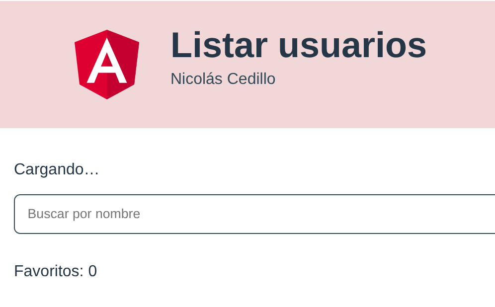
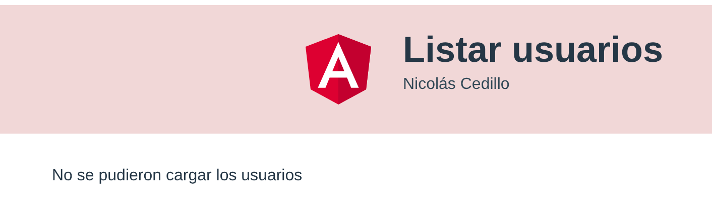
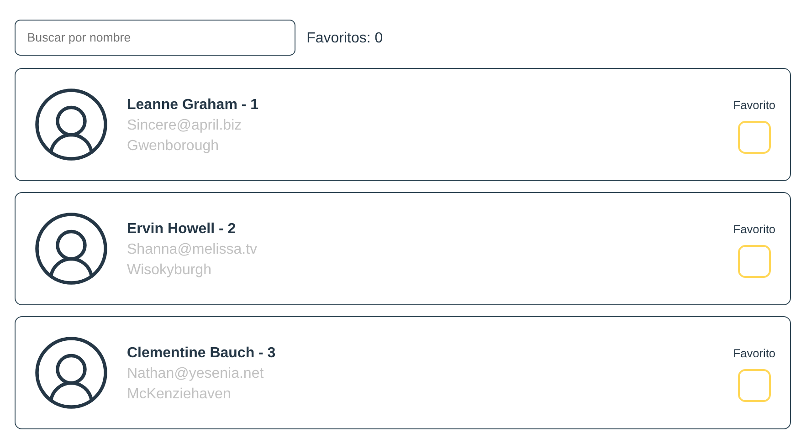
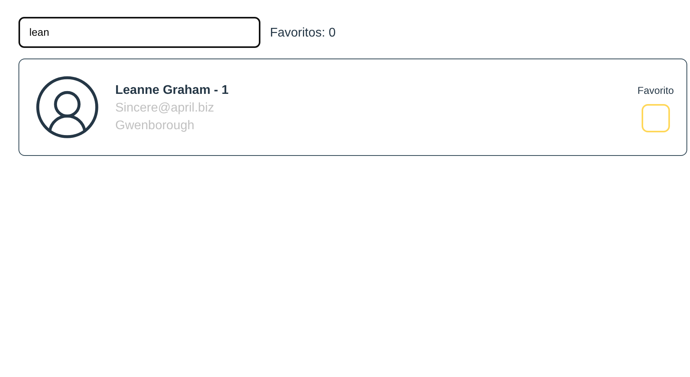
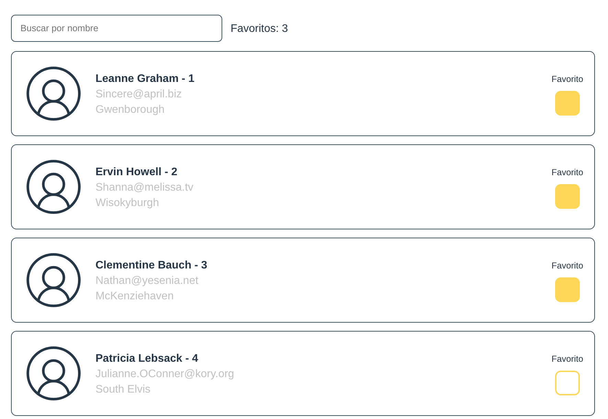
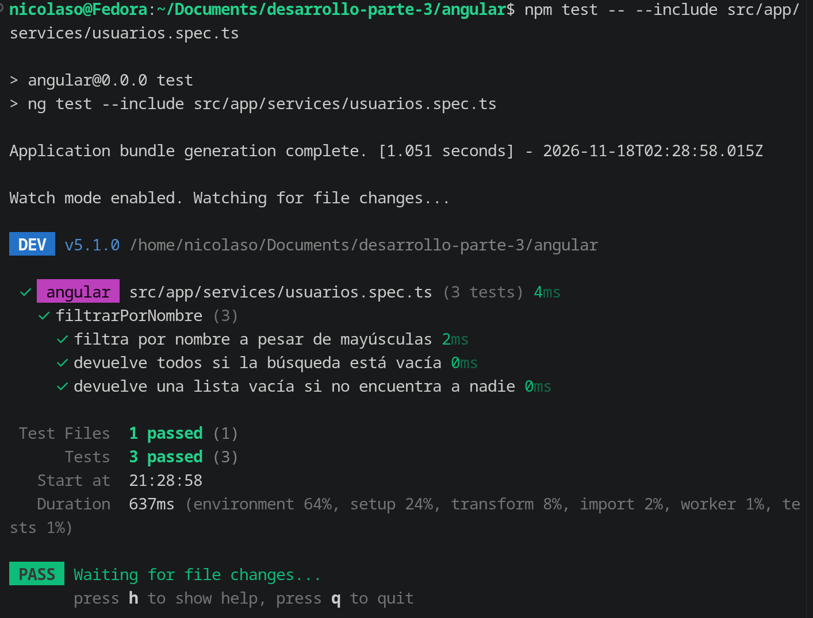
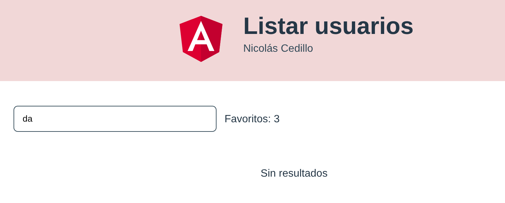
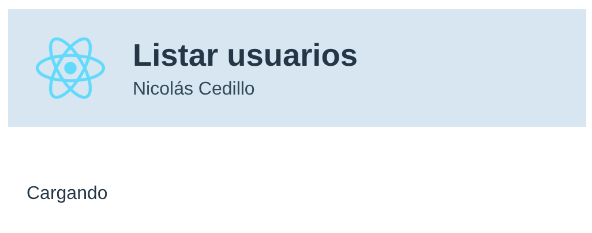
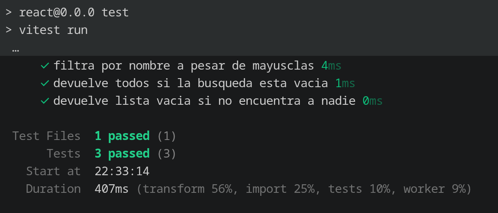

# Listar usuarios en React y Angular
Nombre: Nicolás Cedillo

---
## Ejecución 

### Angular 

Instalar Angular CLI
```shell
npm install -g @angular/cli
```

Creación del proyecto
```shell
ng new angular --routing --style css
```

Levantar el servidor
```shell
ng serve
```

Ejecutar pruebas
```shell
npm test -- --watch=false
```

Ejecutar una sola prueba
```shell
npm test -- --watch=false --include src/app/services/usuarios.spec.ts
```

Generar versión para producción
```shell
npm run build
```

### React

Instalar dependencias
```shell
npm install
```

Instalar paquete para pruebas
```shell
npm install -D vitest
```

Creación de proyecto
```shell
npm create vite@latest app-react -- --template react
```

Levantar el servidor
```shell
npm run dev 
```
Ejecutar pruebas
```shell
npm test
```

Generar versión para producción
```shell
npm run build
```

---

## Evidencias


### Angular

1. Proyecto corriendo


2. "Cargando"


3. Mensaje de error


4. Lista de tarjetas



5. Búsqueda filtrando



6. Favoritos + contador



7. Prueba unitaria pasando



8. Extras



### React 

1. Proyecto corriendo


2. "Cargando"


3. Mensaje de error


4. Lista de tarjetas


5. Búsqueda filtrando


6. Favoritos + contador


7. Prueba pasada



8. Extras
