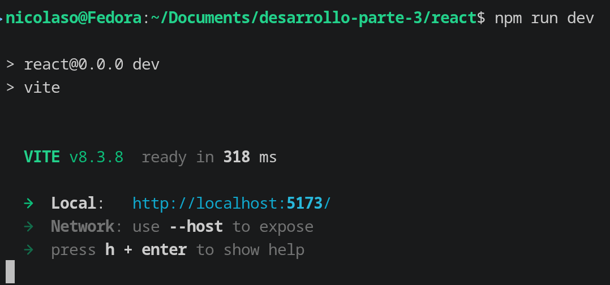
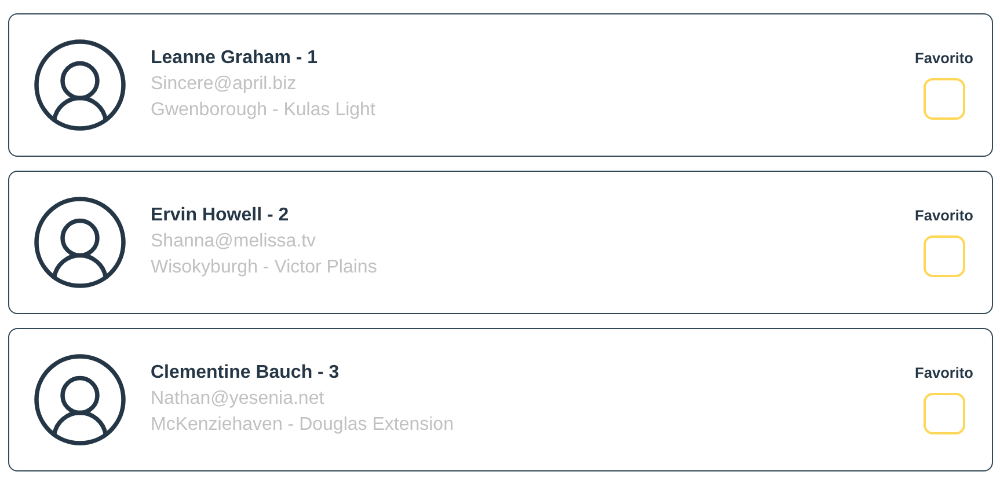
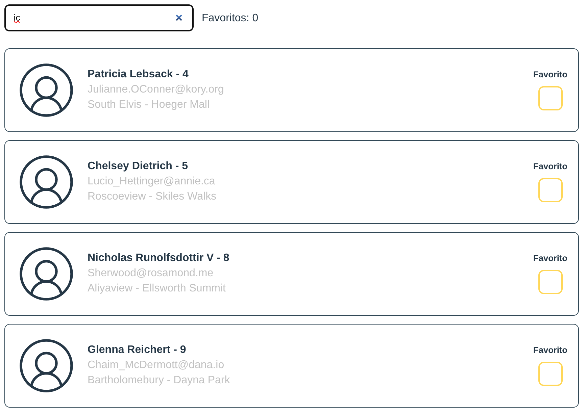
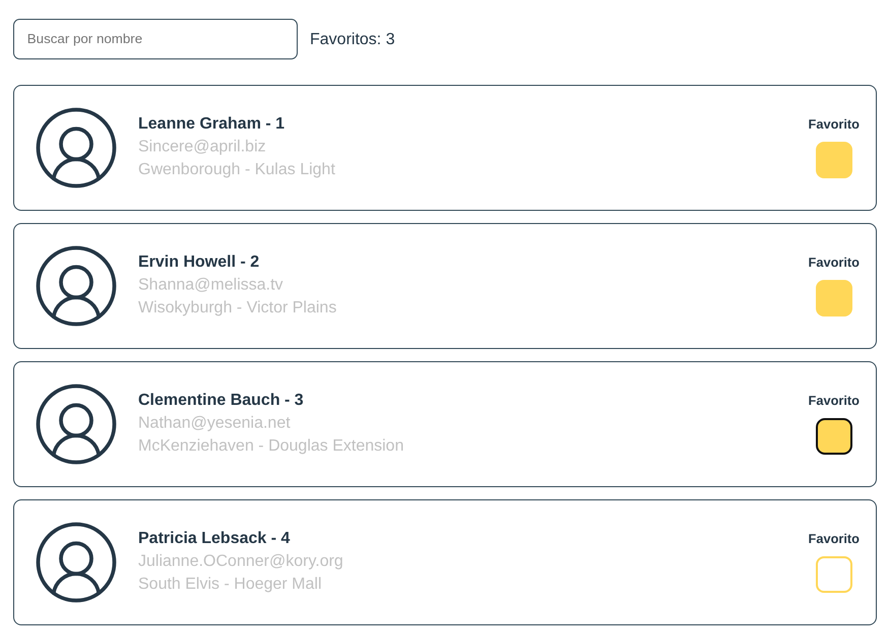
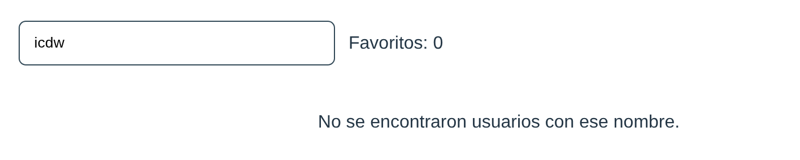

# Listar usuarios en React y Angular
Nombre: Nicolás Cedillo

---
## Ejecución 

### Angular 


### React

Instalar dependencias
```shell
npm install
```

Instalar paquete para pruebas
```shell
npm install -D vitest
```

Creación de proyecto
```shell
npm create vite@latest app-react -- --template react
```

Levantar el servidor
```shell
npm run dev 
```
Ejecutar pruebas
```shell
npm test
```

Generar versión para producción
```shell
npm run build
```

---

## Evidencias


### Angular

1. Proyecto corriendo
2. "Cargando…"
3. Mensaje de error
4. Lista de tarjetas
5. Búsqueda filtrando
6. Favoritos + contador
7. Prueba unitaria pasando
8. Extras

### React 

1. Proyecto corriendo


2. "Cargando"


3. Mensaje de error


4. Lista de tarjetas


5. Búsqueda filtrando


6. Favoritos + contador


7. Prueba pasada


8. Extras
